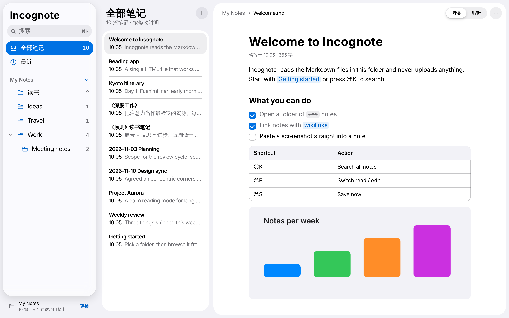
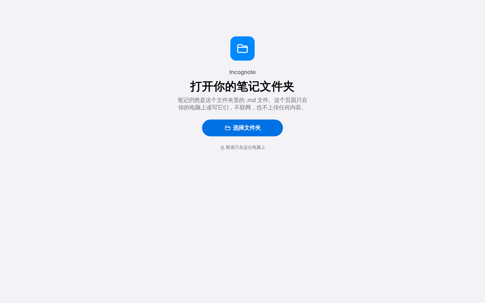
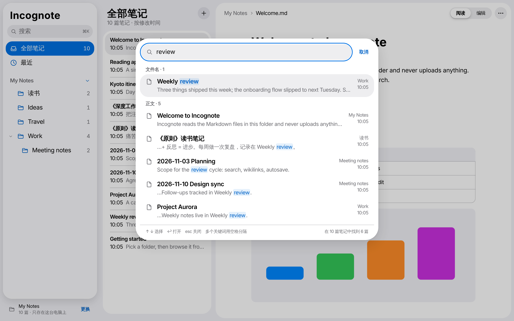
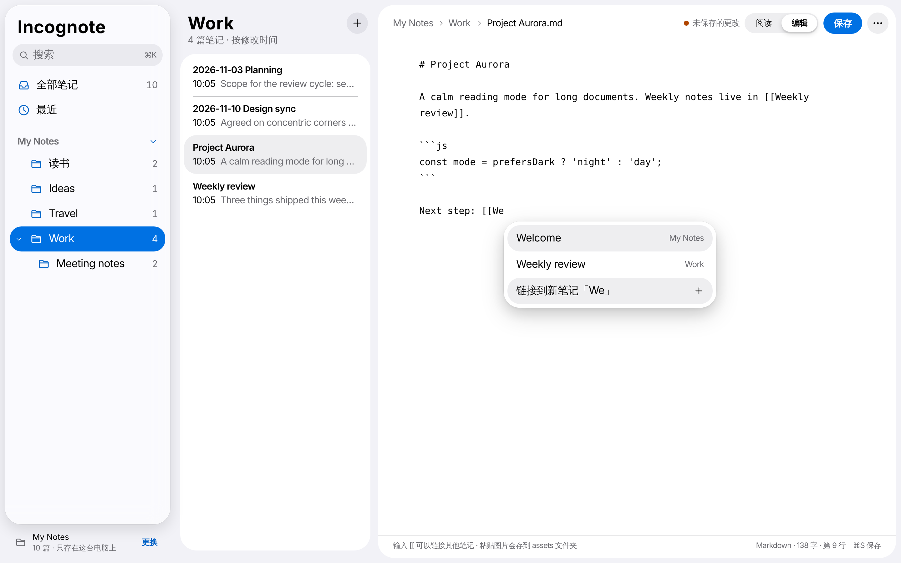
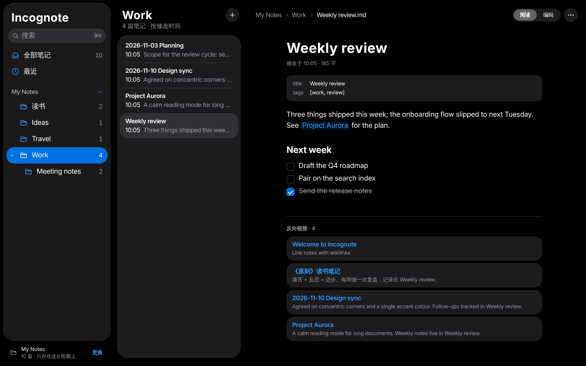

# Incognote

**English** · [简体中文](README.zh-CN.md)

A private, local-only Markdown notebook that lives in a single HTML file.

Open `incognote.html` in Chrome or Edge, pick a folder of `.md` notes, and you can browse, search and edit them. Your notes stay plain Markdown files in your own folder. Nothing is uploaded, and the page never loads anything from the network on its own.



## Why

- **Nothing leaves your computer.** The page ships with a Content Security Policy of `default-src 'none'`, so the browser blocks every request the page tries to make, including remote images inside your notes. It works fully offline. (A web link in a note opens in a new tab only when you click it.)
- **Nothing to install.** One HTML file with all code inlined: no CDN, no web fonts, no analytics, no server, no account.
- **Your files stay yours.** Incognote reads and writes ordinary `.md` files. You can keep using any other editor, sync tool or Git on the same folder.

## Getting started

You only need one file.

1. Download **[incognote.html](https://github.com/VibeMage/incognote/releases/latest/download/incognote.html)** from the [latest release](https://github.com/VibeMage/incognote/releases/latest) and put it anywhere, for example next to your notes.
2. Open it in **Chrome or Edge** (double-clicking the file is fine, no server needed).
3. Click **选择文件夹** (Choose folder), pick your notes folder and allow **View and edit** files.
4. Next time, click **继续使用上次的文件夹** (Continue with last folder) on the welcome screen. The browser asks you to confirm access once per session.



Safari and Firefox do not support writing to local folders. In those browsers Incognote opens the folder **read-only**, so you can browse and search but not edit.

> The interface is currently in Chinese. Notes can be in any language.

## Features

| | |
| --- | --- |
| **Folders** | Folder tree in the sidebar with nested subfolders; notes listed by last modified |
| **Reading** | Markdown with headings, tables, task lists you can tick, code blocks, quotes, YAML front matter, and local images |
| **Wikilinks** | `[[Note]]`, `[[Note\|label]]`, `[[Note#Heading]]`, `![[image.png]]`; clicking a missing link creates the note; backlinks at the bottom of each note |
| **Editing** | ⌘E toggles read / edit; typing `[[` suggests notes; pasted screenshots are saved to an `assets/` folder next to the note |
| **Saving** | Autosaves 1.5 s after you stop typing, ⌘S saves immediately, and you are warned before closing with unsaved changes |
| **Conflicts** | Before saving, Incognote checks whether the file was changed elsewhere (another editor, a sync tool) and asks before overwriting |
| **Managing** | Create, rename (links in other notes are updated), and delete (asks first, permanent) |
| **Search** | ⌘K searches every note; multiple words separated by spaces; results grouped by file name and content, with highlights |
| **Appearance** | Follows the system light / dark setting |

On Windows use Ctrl instead of ⌘.







The screenshots use a small made-up demo folder.

## How it works

Incognote is a plain web page with no backend. Everything happens inside the browser tab.

**Folder access.** It uses the browser's [File System Access API](https://developer.mozilla.org/docs/Web/API/File_System_API). `showDirectoryPicker({ mode: 'readwrite' })` gives the page a handle to the folder you choose, and only that folder. The handle is kept in the page's IndexedDB so the folder can be reopened next time, but the browser still asks you to confirm access. Browsers without this API fall back to `<input webkitdirectory>`, which is read-only.

**Indexing.** On open, Incognote walks the folder, reads every `.md` file into memory, and extracts the title (first `# heading`, front matter `title`, or file name), a preview line and outgoing wikilinks. Hidden folders such as `.git` and `.obsidian`, and `node_modules`, are skipped. When the tab regains focus it rescans, re-reading only files whose modification time changed.

**Rendering.** Markdown is parsed by markdown-it, extended with small custom rules for wikilinks, image embeds and clickable task lists. The resulting HTML is cleaned by DOMPurify before it is shown, so a note cannot run scripts or inject styles. Local images are read from the folder and displayed through `blob:` URLs.

**Search.** Search runs in memory over the full text of every note, so it is instant for a few thousand notes. All words must match; file name matches are listed first.

**Saving.** Each open note remembers the text it started from. Before writing, Incognote re-reads the file from disk. If the file changed in the meantime, it asks you before overwriting. Renames rewrite `[[links]]` in other notes, skipping fenced code blocks and inline code.

**Zero network.** The Content Security Policy at the top of the file is `default-src 'none'`, which allows only the page's own inline scripts and styles, `blob:` and `data:` images, and `blob:` media. It also sets `base-uri 'none'` and `form-action 'none'`. Even if a note contains ``, the browser refuses to load it. You can check this yourself in DevTools → Network.

### Libraries

Both libraries are bundled into the HTML file. Nothing is loaded at runtime.

| Library | Version | Used for | License |
| --- | --- | --- | --- |
| [markdown-it](https://github.com/markdown-it/markdown-it) | 14.1.0 | Parsing Markdown to HTML | MIT |
| [DOMPurify](https://github.com/cure53/DOMPurify) | 3.2.6 | Sanitizing rendered HTML | Apache-2.0 or MPL-2.0 |

Everything else (file handling, wikilinks, search, editor, UI) is plain JavaScript and CSS with no framework. Icons are hand-drawn SVGs in an SF Symbols-like style. The library license texts are in `src/vendor/`.

## Development

```
src/app.html          app source (HTML, CSS, JS)
src/icons.json        SVG icons
src/vendor/           markdown-it and DOMPurify, with their licenses
build.py              inlines everything into incognote.html
incognote.html        the built single file
```

After changing anything in `src/`, rebuild:

```sh
python3 build.py
```
