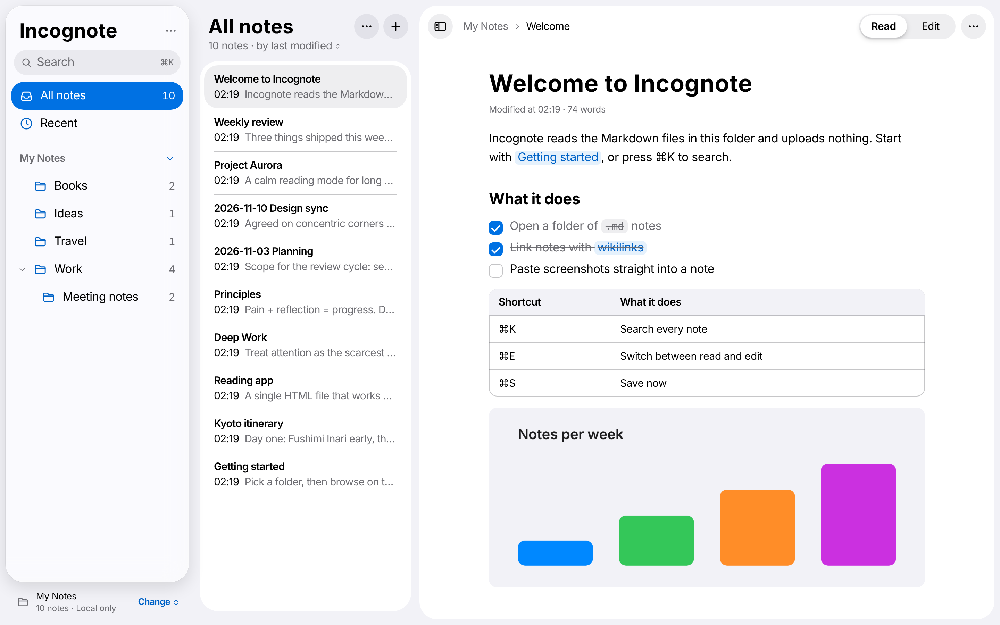
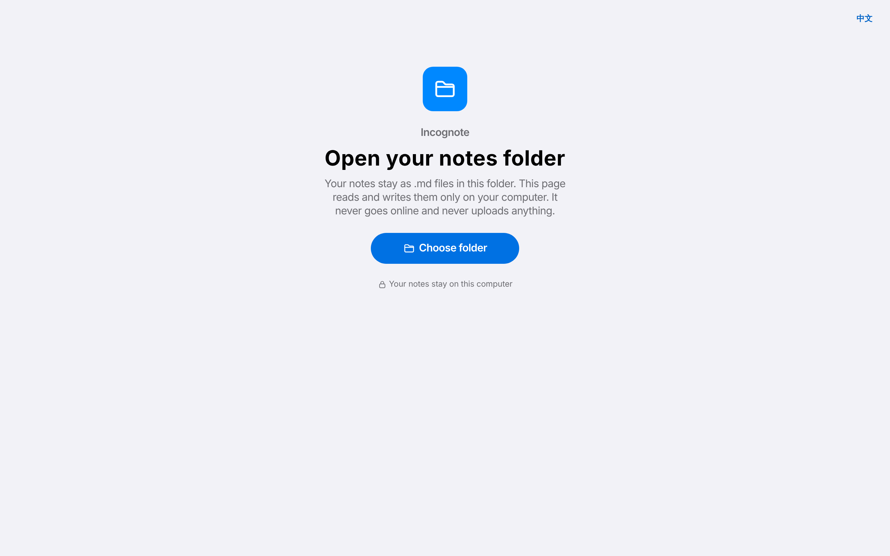
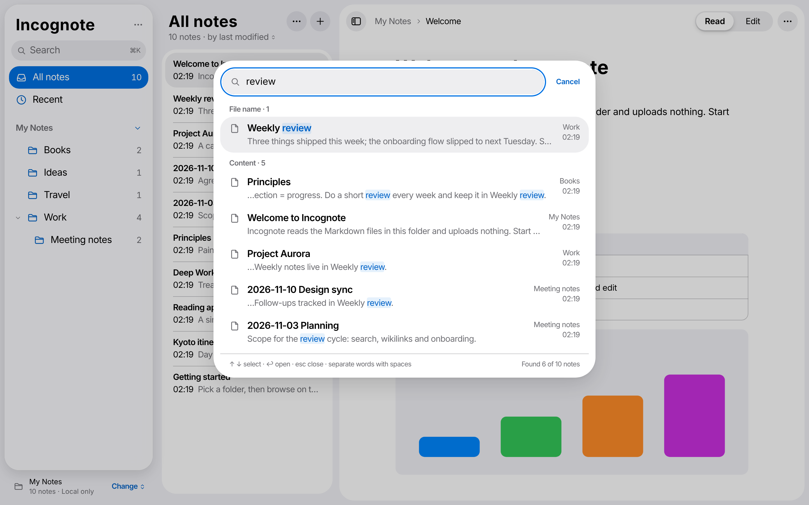
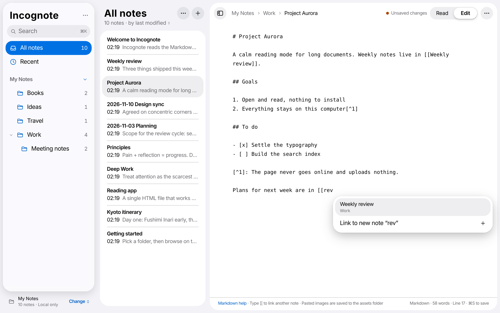
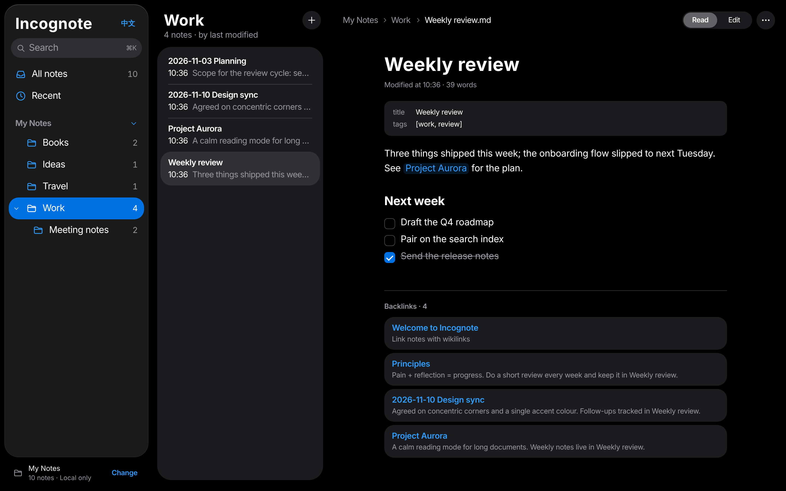

# Incognote

**English** · [简体中文](README.zh-CN.md)

A private, local-only Markdown notebook that lives in a single HTML file.

Open `incognote.html` in Chrome or Edge, pick a folder of `.md` notes, and you can browse, search and edit them. Your notes stay plain Markdown files in your own folder. Nothing is uploaded, and the page never loads anything from the network on its own.



## Why

- **Nothing leaves your computer.** The page ships with a Content Security Policy of `default-src 'none'`, so the browser blocks every request the page tries to make, including remote images inside your notes. It works fully offline. (A web link in a note opens in a new tab only when you click it.)
- **Nothing to install.** One HTML file with all code inlined: no CDN, no web fonts, no analytics, no server, no account.
- **Your files stay yours.** Incognote reads and writes ordinary `.md` files. You can keep using any other editor, sync tool or Git on the same folder.

## Getting started

You only need one file.

1. Download **[incognote.html](https://github.com/VibeMage/incognote/releases/latest/download/incognote.html)** from the [latest release](https://github.com/VibeMage/incognote/releases/latest) and put it anywhere, for example next to your notes.
   You can also open [incognote.html](incognote.html) in this repository and click **Download raw file**. It is the same file.
2. Open it in **Chrome or Edge** (double-clicking the file is fine, no server needed).
3. Pick where your notes live:
   - **No notes yet?** Click **New notes folder**. In the folder picker, click **New Folder**, name it (for example “Notes”), select it and confirm, then allow Chrome to **edit** files. Incognote adds three short getting-started notes (welcome, a Markdown cheat sheet, links and images) in their own folder, so you can delete them later in one go. Chrome doesn't allow Documents, Desktop or Downloads themselves, so pick or make a folder inside them. If you pick a folder that already has other files, Incognote makes an “Incognote Notes” folder inside it and leaves everything else alone.
   - **Already have Markdown notes?** Click **Open an existing notes folder**, pick that folder and allow **View and edit** files.
4. Next time, Incognote reopens the same folder. If Chrome asks again, click **Open “your folder”** and choose **Allow on every visit** in the prompt; from then on the page goes straight to your notes.
5. To switch folders or start another one, click the folder name at the bottom of the sidebar. It lists recently opened folders and lets you open or create another one.

If the folder you open has no `.md` files, Incognote says so and offers to choose another folder, add the getting-started notes, or start writing. While editing, **Markdown help** in the bottom bar shows a short cheat sheet.



Safari and Firefox do not support writing to local folders. In those browsers Incognote opens the folder **read-only**, so you can browse and search but not edit. They may call choosing a folder an “upload”; the files are only read by the page and never leave your computer. Phone and tablet browsers can't open local folders.

> The interface is in English or Chinese. It follows your browser language, and you can switch with the **中文 / EN** button at the top of the sidebar. Notes can be in any language.

## Features

| | |
| --- | --- |
| **Folders** | Folder tree in the sidebar with nested subfolders; notes listed by last modified |
| **Reading** | Markdown with headings, tables, task lists you can tick, code blocks, quotes, YAML front matter, and local images |
| **Wikilinks** | `[[Note]]`, `[[Note\|label]]`, `[[Note#Heading]]`, `![[image.png]]`; clicking a missing link creates the note; backlinks at the bottom of each note |
| **Editing** | ⌘E toggles read / edit; typing `[[` suggests notes; pasted screenshots are saved to an `assets/` folder next to the note |
| **Saving** | Autosaves 1.5 s after you stop typing, ⌘S saves immediately, and you are warned before closing with unsaved changes |
| **Live updates** | Changes made outside Incognote (Claude Code, another editor, a sync tool) show up within seconds while the page is open; changed notes get a blue dot until you open them |
| **Conflicts** | If a note you are editing changes on disk, autosave pauses and a bar lets you compare the two versions line by line, then keep yours or take the file's |
| **Managing** | Create, rename (links in other notes are updated), and delete (asks first, permanent) |
| **Search** | ⌘K searches every note; multiple words separated by spaces; results grouped by file name and content, with highlights |
| **Appearance** | Follows the system light / dark setting |
| **Claude Code** | One click writes a `CLAUDE.md` guide and a note-management skill into your folder (see below) |
| **Language** | English and Chinese interface; follows the browser, switch any time, and the choice is remembered |

On Windows and Linux use Ctrl instead of ⌘. The app shows the right key for your system.







The screenshots use a small made-up demo folder.

## Working with Claude Code

Your notes are ordinary `.md` files, so [Claude Code](https://claude.com/claude-code) can search, read, create and edit them directly. Incognote doesn't connect to it in any way. It only makes the two work well side by side:

1. In Incognote, click **Change** at the bottom of the sidebar, then **Use with Claude Code…**, then **Create**. This adds two files to your notes folder, and never overwrites existing ones:
   - `CLAUDE.md` describes how the notebook works: file names, titles, front matter, `[[links]]`, where images go, and to ask before deleting or bulk-changing notes. Claude Code reads it automatically.
   - `.claude/skills/incognote-notes/SKILL.md` gives Claude step-by-step instructions for creating notes, renaming or moving a note while updating every link to it, and a tidy-up check (broken links, duplicate names, orphan notes, unused images).

   Neither file appears in the note list or search. Edit them however you like.

   If your folder already has a `CLAUDE.md` or the skill (for example from another notes app) and it doesn't fit, click **Regenerate** next to it. The old file is copied to `.claude/backup/` first.
2. Open a terminal in your notes folder and run `claude`. Ask things like “summarize what I wrote about X”, “file this into a new note”, or “rename note A to B”.
3. Keep Incognote open next to it. Notes Claude changes appear within seconds, marked with a blue dot. If Claude changes the note you are editing, nothing is overwritten: you choose which version to keep.

Tip: run `git init` in the notes folder (or let Claude suggest it) so any change Claude makes can be undone. Incognote ignores the `.git` folder.

## How it works

Incognote is a plain web page with no backend. Everything happens inside the browser tab.

**Folder access.** It uses the browser's [File System Access API](https://developer.mozilla.org/docs/Web/API/File_System_API). `showDirectoryPicker({ mode: 'readwrite' })` gives the page a handle to the folder you choose, and only that folder. The handles of recently opened folders are kept in the page's IndexedDB. On load the page calls `queryPermission()` on the last one: if Chrome still allows access (for example after **Allow on every visit**), it opens directly; otherwise one click calls `requestPermission()`, which needs a user gesture. Browsers without this API fall back to `<input webkitdirectory>`, which is read-only.

**Indexing.** On open, Incognote walks the folder, reads every `.md` file into memory, and extracts the title (first `# heading`, front matter `title`, or file name), a preview line and outgoing wikilinks. Hidden folders such as `.git` and `.obsidian`, and `node_modules`, are skipped. It rescans when the tab regains focus, and while the tab is visible either when Chrome's `FileSystemObserver` reports a change or every few seconds, re-reading only files whose modification time changed. Top-level `CLAUDE.md` and `AGENTS.md` are treated as instructions for coding agents, not notes.

**Rendering.** Markdown is parsed by markdown-it, extended with small custom rules for wikilinks, image embeds and clickable task lists. The resulting HTML is cleaned by DOMPurify before it is shown, so a note cannot run scripts or inject styles. Local images are read from the folder and displayed through `blob:` URLs.

**Search.** Search runs in memory over the full text of every note, so it is instant for a few thousand notes. All words must match; file name matches are listed first.

**Saving.** Each open note remembers the text it started from. Before writing, Incognote re-reads the file from disk. If the file changed in the meantime, it stops and shows a bar where you choose which version to keep, with a line-by-line diff. Renames rewrite `[[links]]` in other notes, skipping fenced code blocks and inline code.

**Zero network.** The Content Security Policy at the top of the file is `default-src 'none'`, which allows only the page's own inline scripts and styles, `blob:` and `data:` images, and `blob:` media. It also sets `base-uri 'none'` and `form-action 'none'`. Even if a note contains ``, the browser refuses to load it. You can check this yourself in DevTools → Network.

### Libraries

Both libraries are bundled into the HTML file. Nothing is loaded at runtime.

| Library | Version | Used for | License |
| --- | --- | --- | --- |
| [markdown-it](https://github.com/markdown-it/markdown-it) | 14.1.0 | Parsing Markdown to HTML | MIT |
| [DOMPurify](https://github.com/cure53/DOMPurify) | 3.2.6 | Sanitizing rendered HTML | Apache-2.0 or MPL-2.0 |

Everything else (file handling, wikilinks, search, editor, UI) is plain JavaScript and CSS with no framework. Icons are hand-drawn SVGs in an SF Symbols-like style. The library license texts are in `src/vendor/`.

## Development

```
src/app.html          app source (HTML, CSS, JS)
src/icons.json        SVG icons
src/vendor/           markdown-it and DOMPurify, with their licenses
build.py              inlines everything into incognote.html
incognote.html        the built single file
```

After changing anything in `src/`, rebuild:

```sh
python3 build.py
```
