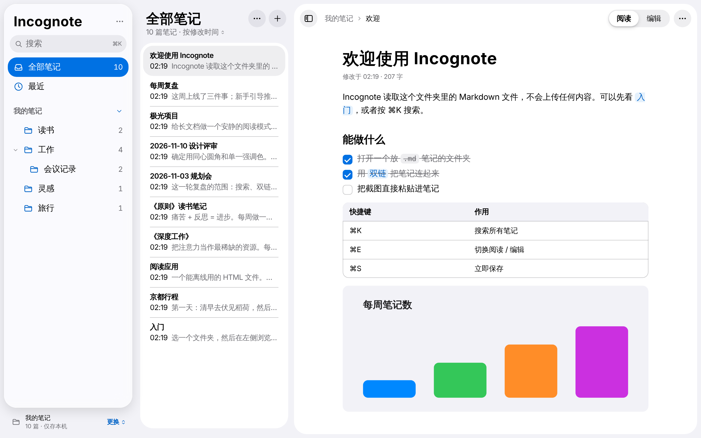
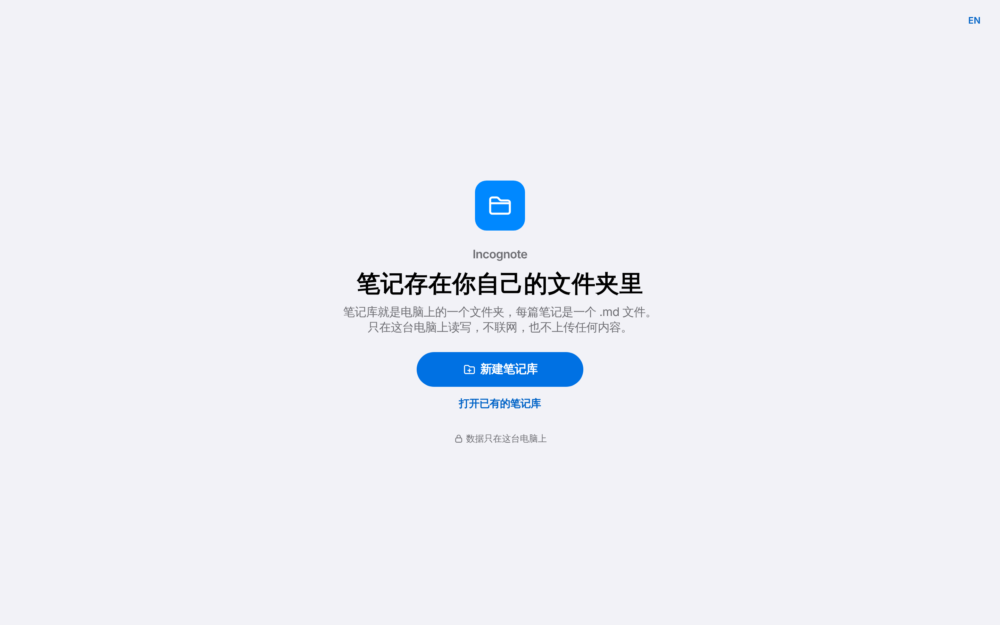
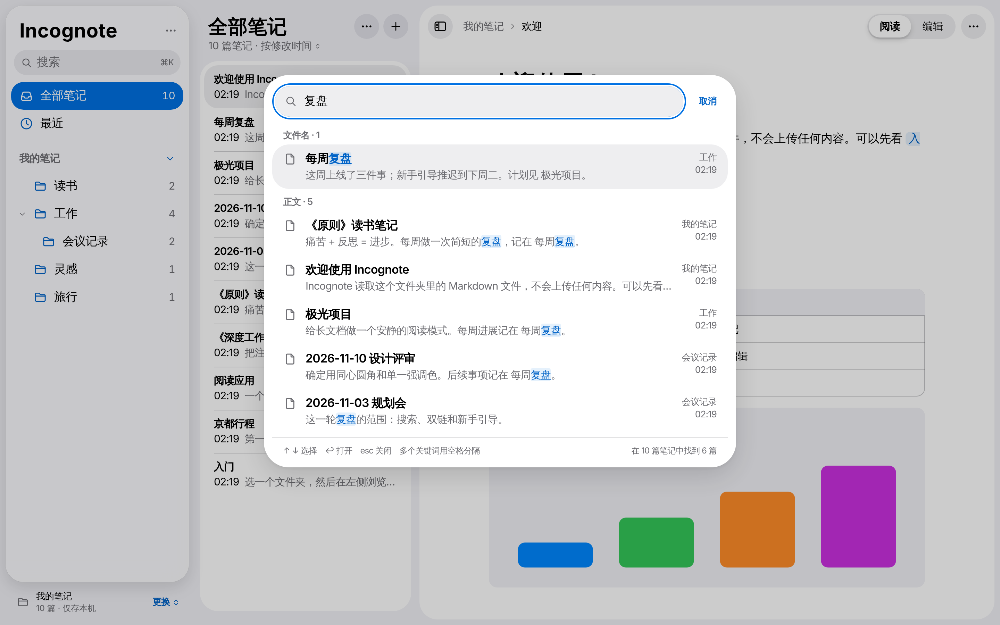
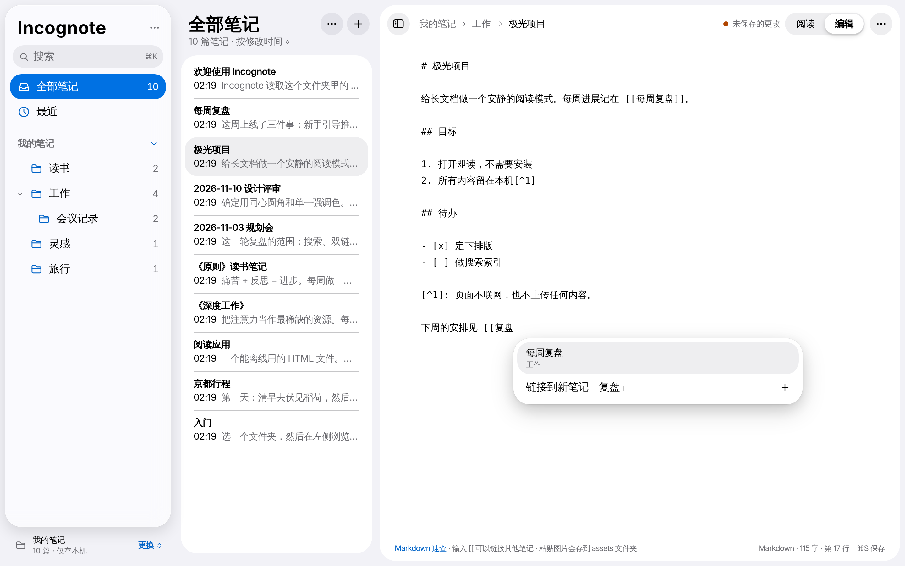
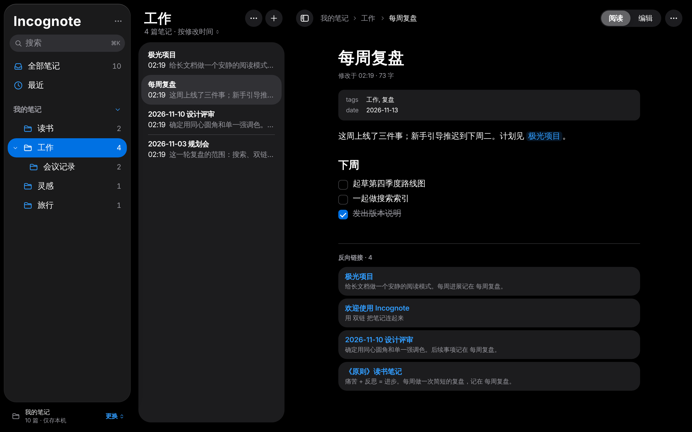

# Incognote

[English](README.md) · **简体中文**

一个 HTML 文件就是一个纯本地、零上传的 Markdown 笔记本。

用 Chrome 或 Edge 打开 `incognote.html`，选一个放 `.md` 笔记的文件夹，就能浏览、搜索和编辑。笔记始终是你自己文件夹里的普通 Markdown 文件，不会上传到任何地方，页面也从不自己联网加载任何东西。



## 为什么用它

- **数据不出电脑**：页面带有内容安全策略（CSP `default-src 'none'`），页面发出的任何网络请求都会被浏览器拦截，包括笔记里引用的外部图片。断网也能正常用。（笔记里的网页链接只有在你点击时才会在新标签页打开。）
- **不用安装**：只有一个 HTML 文件，所有代码都内联在里面，没有 CDN、网络字体、统计脚本、服务器或账号。
- **文件还是你的**：Incognote 读写的就是普通 `.md` 文件。同一个文件夹照样可以用别的编辑器、同步工具或 Git。

## 怎么用

只需要下载一个文件。

1. 从[最新版本](https://github.com/VibeMage/incognote/releases/latest)下载 **[incognote.html](https://github.com/VibeMage/incognote/releases/latest/download/incognote.html)**，放在哪里都行，比如放在笔记文件夹旁边。
   也可以在仓库里打开 [incognote.html](incognote.html)，点 **Download raw file** 下载，是同一个文件。
2. 用 **Chrome 或 Edge** 打开它（直接双击文件即可，不需要服务器）。
3. 选择笔记放在哪里：
   - **还没有笔记？** 点 **新建笔记库**。在弹出的选择窗口里点 **新建文件夹**，起个名字（比如“笔记”），选中它并确认，然后允许 Chrome **编辑**文件。Incognote 会放进三篇简短的入门笔记（欢迎、Markdown 速查、双链和图片），它们单独放在一个文件夹里，以后可以一次删掉。“文稿”“桌面”“下载”这几个文件夹本身 Chrome 不让直接选，选或新建它们里面的文件夹就行。如果选的文件夹里已经有别的文件，Incognote 会在里面新建一个“Incognote 笔记”文件夹，不会动原来的文件。
   - **已经有 Markdown 笔记？** 点 **打开已有的笔记库**，选那个文件夹，在弹窗里允许 **查看和编辑** 文件。
4. 下次打开会回到同一个文件夹。如果 Chrome 再次询问，点 **打开“你的文件夹”**，在提示里选 **每次访问时都允许**，以后打开页面就直接进入笔记。
5. 想换笔记库或再建一个，点侧边栏底部的 **更换**，里面有最近打开过的笔记库，也可以打开或新建别的。

如果打开的文件夹里没有 `.md` 文件，Incognote 会提示你，可以换一个文件夹、放入入门笔记，或者直接开始写。编辑时点底栏的 **Markdown 速查**，可以看常用写法。

> 界面支持中文和英文，默认跟随浏览器语言，也可以点 Incognote 名字旁边的 **⋯** 随时切换，选择会被记住。外观（跟随系统、浅色、深色）、废纸篓和 Claude Code 也在这个菜单里。笔记内容用什么语言都可以。



Safari 和 Firefox 不支持写入本地文件夹，在这两个浏览器里会以**只读**方式打开，可以浏览和搜索，不能编辑。它们可能把选择文件夹叫作“上传”，其实文件只在页面里读取，不会离开你的电脑。手机和平板上的浏览器打不开本地文件夹。

## 功能

| | |
| --- | --- |
| **文件夹** | 左侧是文件夹树，默认收起，展开状态会记住；很多只放一篇笔记的文件夹会折叠成一行。可以新建、重命名、删除文件夹，把笔记移到别的文件夹 |
| **列表** | 中间列出笔记，可按修改时间或标题排序；“最近”是你最近打开过的笔记 |
| **阅读** | Markdown 渲染：标题、表格、可直接勾选的任务列表、代码块（带复制按钮）、引用、脚注、YAML 属性（front matter）、本地图片（点一下放大）；笔记菜单里有大纲 |
| **双链** | `[[笔记名]]`、`[[笔记名\|显示文字]]`、`[[笔记名#标题]]`、`![[图片.png]]`；点不存在的链接会先问要不要新建；每篇笔记底部显示反向链接 |
| **编辑** | ⌘E 切换阅读 / 编辑；回车自动续写列表、待办和引用；输入 `[[` 弹出笔记补全；粘贴截图会存到笔记旁边的 `assets/` 文件夹 |
| **命名** | 新笔记写好第一行 `# 标题` 后，文件自动用标题命名；点顶部路径里的笔记名可以直接改名，其他笔记里指向它的链接会同步更新 |
| **保存** | 停止输入 1.5 秒后自动保存，⌘S 立即保存；关闭页面前如有未保存内容会提醒 |
| **前进后退** | 浏览器的后退、前进（⌘[ 和 ⌘]）在看过的笔记之间切换；顶部路径里的文件夹可以点 |
| **实时更新** | 页面开着时，在别处（Claude Code、其他编辑器、同步工具）做的修改几秒内就会显示出来；被改过的笔记标上蓝点，打开后消失 |
| **冲突** | 你正在编辑的笔记如果在磁盘上被改了，自动保存会暂停，提示条里可以逐行对比两个版本，再决定保留哪个 |
| **删除** | 删除的笔记和文件夹移到笔记库里的 `.trash` 文件夹，几秒内可以撤销，之后也能在废纸篓里放回原处或清空 |
| **搜索** | ⌘K 搜索所有笔记，多个关键词用空格分隔；结果按“文件名”和“正文”分组并高亮，按相关度排序 |
| **布局** | 窗口变窄时边栏和列表收进抽屉；⌘\ 收起或展开边栏，⌘⇧\ 只留正文 |
| **外观** | 跟随系统，也可以手动选浅色或深色 |
| **Claude Code** | 一键在笔记文件夹里生成 `CLAUDE.md` 说明和管理笔记的技能（见下文） |
| **语言** | 中文和英文界面；默认跟随浏览器，可随时切换并记住选择 |

Windows 和 Linux 上用 Ctrl 代替 ⌘，界面会自动显示对应的按键。







截图用的是一个虚构的示例笔记文件夹。

## 配合 Claude Code

笔记就是普通的 `.md` 文件，所以 [Claude Code](https://claude.com/claude-code) 可以直接搜索、阅读、新建和修改它们。Incognote 不和它做任何连接，只是让两者并排用得顺：

1. 在 Incognote 里点名字旁边的 **⋯**，再点 **配合 Claude Code…**，然后点 **全部创建**。它会在笔记文件夹里放两个文件，已有的不会被覆盖：
   - `CLAUDE.md`：这个笔记库的约定，包括文件名、标题、属性、`[[双链]]`、图片放哪里，以及删除或批量修改前要先问你。Claude Code 会自动读取。
   - `.claude/skills/incognote-notes/SKILL.md`：给 Claude 的操作步骤，包括新建笔记、改名或移动笔记并同步更新所有链接、整理体检（断链、同名笔记、孤立笔记、没用到的图片）。

   这两个文件不会出现在笔记列表和搜索里，可以随意修改。

   如果文件夹里已经有 `CLAUDE.md` 或这个 skill（比如别的笔记软件留下的），而它不合适，点它旁边的 **重新生成**。旧文件会先备份到 `.claude/backup/`。
2. 在终端里进入笔记文件夹，运行 `claude`。可以让它“总结我关于 X 写过的内容”“把这段整理成一篇新笔记”“把笔记 A 改名为 B”。
3. 把 Incognote 开在旁边。Claude 改过的笔记几秒内就会显示出来，并标上蓝点。如果 Claude 改了你正在编辑的那篇，不会覆盖任何内容，由你选择保留哪个版本。

建议在笔记文件夹里运行一次 `git init`（也可以让 Claude 提醒你），这样 Claude 做的任何修改都能撤回。Incognote 会忽略 `.git` 文件夹。

## 实现原理

Incognote 是一个没有后端的普通网页，所有事情都在浏览器标签页里完成。

**文件夹访问**：使用浏览器的 [File System Access API](https://developer.mozilla.org/docs/Web/API/File_System_API)。`showDirectoryPicker({ mode: 'readwrite' })` 让页面拿到你所选文件夹（且仅限这个文件夹）的句柄。最近打开的几个文件夹的句柄保存在页面的 IndexedDB 里。页面加载时对上次的文件夹调用 `queryPermission()`：如果 Chrome 仍允许访问（比如选过“每次访问时都允许”），就直接进入；否则点一下按钮调用 `requestPermission()`，这一步浏览器要求必须由用户点击触发。不支持这个 API 的浏览器退回到 `<input webkitdirectory>`，只能只读。

**建立索引**：打开文件夹时遍历所有 `.md` 文件读入内存，提取标题（第一个 `# 标题`、属性里的 `title`，或文件名）、预览摘要和其中的双链。`.git`、`.obsidian` 等隐藏文件夹和 `node_modules` 会被跳过。标签页重新获得焦点时会重新扫描；标签页可见时，Chrome 的 `FileSystemObserver` 报告有变化或每隔几秒也会扫描，只重读修改时间变了的文件。根目录的 `CLAUDE.md` 和 `AGENTS.md` 是给编程助手看的说明，不算笔记。

**渲染**：Markdown 由 markdown-it 解析，并加了几条自定义规则来支持双链、图片嵌入和可勾选的任务列表。生成的 HTML 先经过 DOMPurify 清洗再显示，所以笔记内容无法执行脚本或注入样式。本地图片从文件夹读出后通过 `blob:` 地址显示。

**搜索**：在内存里对所有笔记的全文做匹配，几千篇以内都是即时出结果。所有关键词都要命中；文件名命中的排在前面。

**保存**：每篇打开的笔记都记着它开始编辑时的原文。写入前会重新读取磁盘上的文件，如果期间被别处改过，会停下来显示提示条，可以逐行对比后再选保留哪个版本。重命名或移动笔记、重命名文件夹时会改写其他笔记里指向它的 `[[链接]]` 和 `[文字](路径.md)`，``` 代码块和行内代码里的内容不动。Chrome 不能直接给文件夹改名，所以是先复制到新名字、核对文件数量后再删掉旧文件夹。

**删除**：不直接删文件，而是把它移到笔记库里的 `.trash/`（保持原来的文件夹结构）。以 `.` 开头的文件夹不会出现在列表里。清空废纸篓才是真正删除。

**零联网**：文件开头的内容安全策略是 `default-src 'none'`，只放行页面自带的内联脚本和样式、`blob:` 和 `data:` 图片，以及 `blob:` 媒体，并设置了 `base-uri 'none'` 和 `form-action 'none'`。即使笔记里写了 ``，浏览器也会拒绝加载。你可以在开发者工具的 Network 面板里自己验证。

### 用到的库

两个库都已打包进 HTML 文件，运行时不会加载任何外部资源。

| 库 | 版本 | 用途 | 许可证 |
| --- | --- | --- | --- |
| [markdown-it](https://github.com/markdown-it/markdown-it) | 14.1.0 | 把 Markdown 解析成 HTML | MIT |
| [DOMPurify](https://github.com/cure53/DOMPurify) | 3.2.6 | 清洗渲染出的 HTML，防止脚本注入 | Apache-2.0 或 MPL-2.0 |

其余部分（文件读写、双链、搜索、编辑器、界面）都是不依赖框架的原生 JavaScript 和 CSS。图标是按 SF Symbols 风格手绘的 SVG。两个库的许可证原文在 `src/vendor/`。

## 开发

```
src/app.html          应用源码（HTML、CSS、JS）
src/icons.json        SVG 图标
src/vendor/           markdown-it 和 DOMPurify 及其许可证
build.py              把所有内容内联成 incognote.html
incognote.html        构建好的单文件
```

改了 `src/` 里的内容后重新构建：

```sh
python3 build.py
```
